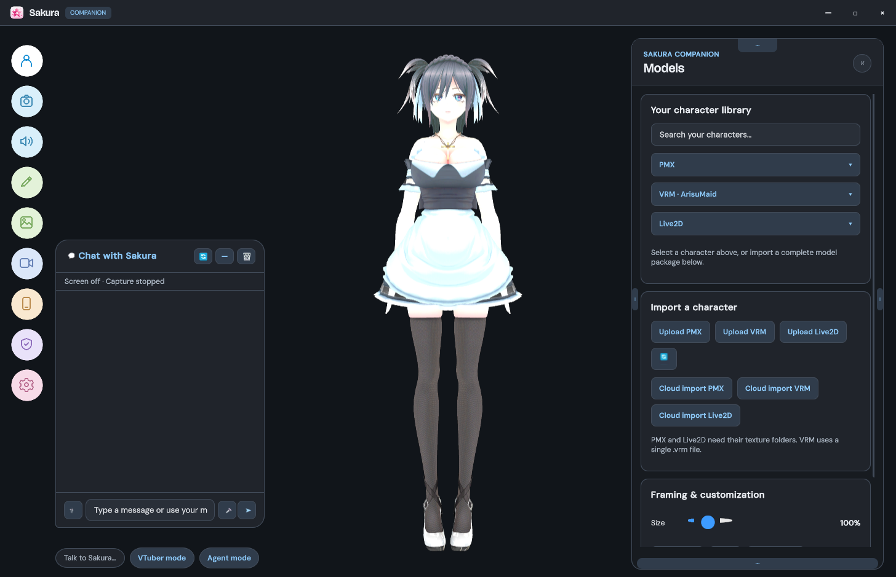
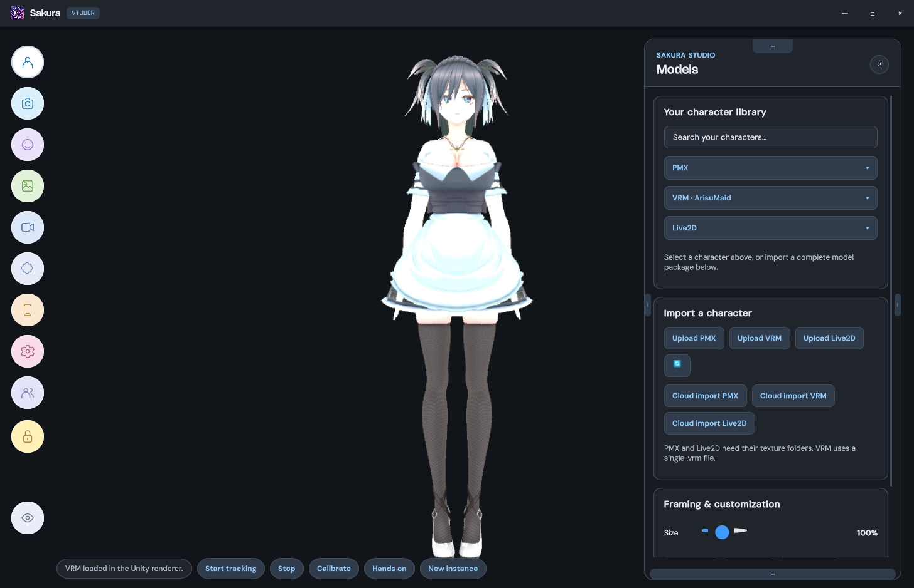
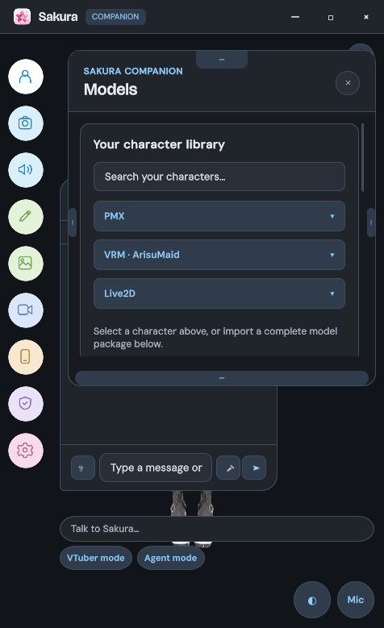

# Sakura Unity

Sakura's Unity 6 app is available as separate **Companion** and **standalone VTuber** installers for Windows x64. **Sakura Mobile** is available as an Android ARM64 preview. Both Windows installers include the backend and its Python runtime.

[Download from GitHub Releases](https://github.com/soulofswords/Sakura-Unity/releases) · [Project site](https://soulofswords.github.io/Sakura-website/)

<p align="center">
  
  
</p>
<p align="center">
  
</p>
<p align="center"><sub>Built players, not Editor captures: VRM rendering, chat and the transparent desktop widget verified in the shipped executables.</sub></p>

## Why Unity

The Python/web original renders avatars in a browser view. Unity gives the project native transparent-window compositing (per-pixel alpha on the desktop), GPU-side rendering for Live2D/PMX/VRM in one viewport, native window placement and multi-instance support, and one codebase for Windows and Android. The intelligence did not move: AI, memory, personas, agent runtime, skills, speech and the model library stay in the Python backend, reached over an **authenticated loopback bridge** (`Tools/backend_bridge.py`). Tokens live in process memory only — never in scenes, assets or source.

## What is in this repo

- `Assets/Sakura/Runtime/` — the client: avatar viewport (VRM via UniVRM, PMX via the MMD loader, Live2D via Cubism), transparent window and placement, tracking rig, expressions and idle motion, stage and props, chat/Agent panels, settings, output (virtual camera/NDI/Spout bridges), plugin WebSocket API.
- `Assets/Sakura/Editor/` — batch build entry points (`SakuraBuild.cs`) and Editor-side parity checks.
- Embedded packages: `com.vrmc.vrm`, `com.vrmc.gltf` (UniVRM), `com.yohawing.mmd-loader` (PMX/MMD), Cubism SDK, `com.webviewtoolkit.core` (embedded Agent browser).
- `Tools/` — the loopback bridge, tracking worker, wake helper, library migration/backup scripts and their tests; copied next to every built player.
- `Docs/` — migration notes and verification screenshots.

## Build

Unity **6000.3.28f1** (Unity 6.3), URP. From a terminal with Unity on PATH, or substitute your Editor path:

```bash
Unity -batchmode -quit -projectPath <this repo> \
  -executeMethod Sakura.Unity.Editor.SakuraBuild.BuildBothWindows \
  -logFile build.log
```

`BuildCompanion` builds Companion and `BuildAndroid` produces the ARM64 IL2CPP APK. Set `SAKURA_BUILD_OUTPUT` to direct the outputs to a separate build folder.

Stage each clean Windows player with `Tools/package_windows.py --source <backend-checkout> --player <player-folder> --output <new-stage-folder> --edition <companion|vtuber>`. The backend checkout must have its release dependencies and runtime cache prepared. Compile `Tools/SakuraWindowsInstaller.iss` with Inno Setup 6, passing `/DEdition=Companion` or `/DEdition=VTuber`, `/DVersion=<version>`, and `/DPayload=<absolute-stage-folder>` to ISCC. The installers use separate per-user directories and keep each edition's existing settings on reinstall.

## Verification

Rendering bugs that only appear in built players (Unity strips shaders no scene references) are guarded by a built-player harness: run any edition with `--sakura-verify` and it loads real Live2D/PMX/VRM models, **counts rendered avatar pixels**, exercises greeting/dance rigs, panels and the transparent window, then writes `built-<edition>-<index>.json` plus screenshots to `C:\AI\Unity-Verification` and quits. `--sakura-verify-hold` keeps the window open for inspection. Example receipt from the current build: VRM import error `null`, 4513 visible avatar pixels, shaders `VRM10/Universal Render Pipeline/MToon10` + `UniGLTF/UniUnlit`, mode isolation and transparent-window restore `true`.

## Status

Active migration, verified per change: VRM/PMX/Live2D rendering, transparent Companion window and restore, edition mode isolation, greeting/dance rigs, settings/panel surfaces and the Agent panel are checked in the built players. Remaining parity edge cases (panel and tracking details) are tracked against the Python reference implementation. The Python app remains the service backend for both clients.

## License

Third-party packages and SDKs (UniVRM, Cubism, MMD tooling, WebView toolkit) retain their own licenses. Character models, artwork and weights are not part of this repository. Application source follows the terms stated in the [main Sakura repository](https://github.com/soulofswords/Sakura).
